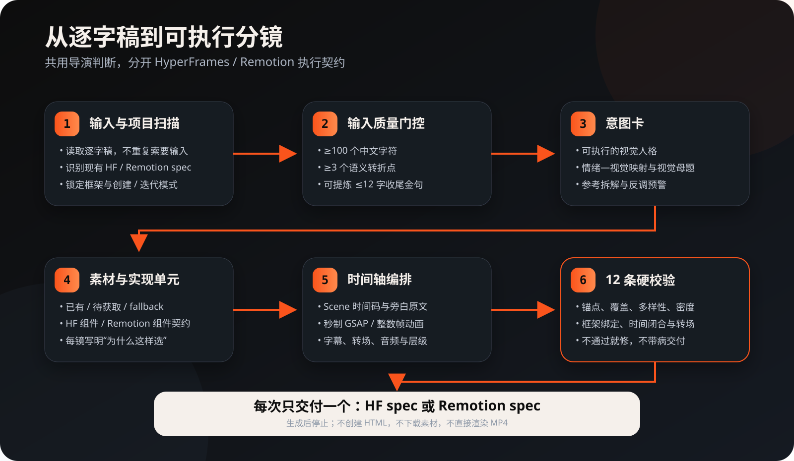
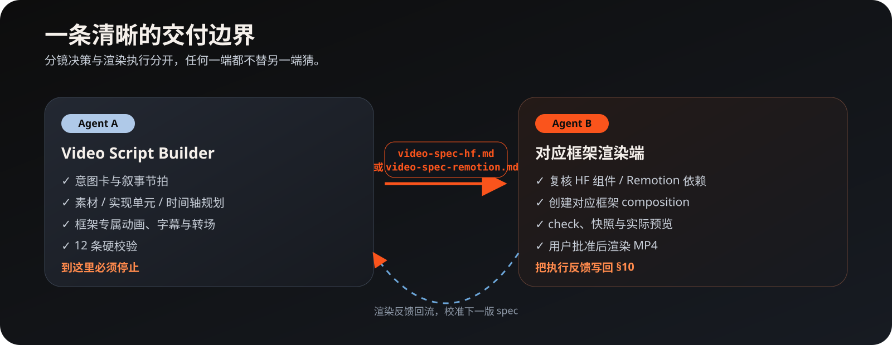

<div align="center">


# Video Script Builder

**把中文视频逐字稿，变成可交给 HyperFrames 或 Remotion 渲染 Agent 的精确分镜规格。**

[](./CHANGELOG.md)
[](./LICENSE)
[](https://github.com/erduo1998-cell/video-script-builder/actions/workflows/validate.yml)

[中文](./README.md) · [English](./README.en.md) · [问题反馈](https://github.com/erduo1998-cell/video-script-builder/issues) · [会员与帮助](#membership-help)

</div>

---

## 这次升级了什么

v1.4.0 在保留原 HyperFrames 工作流的基础上，新增了完整的 Remotion 分镜契约。

核心不是把“HyperFrames”替换成“Remotion”，而是把系统拆成两层：

- **共享导演层**：逐字稿分析、意图卡、素材盘点、叙事节拍、视觉母题、字幕与品味判断；
- **框架适配层**：HyperFrames 使用组件 + 秒制 GSAP；Remotion 使用 React 组件契约 + 整数帧动画。

一次任务只会交付一个框架绑定的 spec：

| 目标框架 | 交付物 | 时间真源 | 动画与实现契约 |
|---|---|---|---|
| HyperFrames | `video-spec-hf.md` | 秒、`data-start`、`data-duration` | 官方组件 + GSAP 胶水 |
| Remotion | `video-spec-remotion.md` | 整数帧、`startFrame`、`durationInFrames` | React 组件 + `useCurrentFrame()` / `interpolate()` / `spring()` |

不会生成一份混写两套框架的“通用 spec”。未指定框架时仍默认 HyperFrames，旧使用方式无需改变。



## 它解决什么问题

你有一篇口播逐字稿，但还不知道每句话该配什么画面、何时切镜、素材放哪里、字幕和转场如何安排，也不想让渲染 Agent 自己猜导演意图。

`video-script-builder` 会让支持 Skill 的 AI Agent：

- 从逐字稿拆出叙事节拍、情绪曲线和精确时间轴；
- 先建立视觉意图，再盘点真实素材与 fallback；
- 根据目标框架选择 HF 官方组件，或定义可实现的 Remotion React 组件契约；
- 规划字幕、转场、配色、层级、音频和动效边界；
- 用 12 条硬阻断检查框架绑定、时间闭合、动画确定性和交接完整度；
- 最终只生成当前框架对应的一份 Markdown 分镜规格。

它**不是视频渲染器**。不会创建 `index.html`、`Root.tsx` 或 composition，不安装依赖、不下载素材，也不会直接输出 MP4。

## 3 分钟上手

### 第 1 步：安装

Claude Code：

```bash
mkdir -p ~/.claude/skills
git clone https://github.com/erduo1998-cell/video-script-builder.git \
  ~/.claude/skills/video-script-builder
```

Codex：

```bash
mkdir -p ~/.codex/skills
git clone https://github.com/erduo1998-cell/video-script-builder.git \
  ~/.codex/skills/video-script-builder
```

如果目标目录已存在，更新时运行：

```bash
git -C ~/.claude/skills/video-script-builder pull
```

Codex 用户把路径替换成 `~/.codex/skills/video-script-builder`。安装或更新后，新开一个 Agent 会话以重新扫描 Skills。

### 第 2 步：确认安装成功

对 Agent 说：

```text
请告诉我 video-script-builder 支持哪些渲染框架，以及每次会交付什么。
```

正确答案应包含 HyperFrames 和 Remotion，并说明一次只交付 `video-spec-hf.md` 或 `video-spec-remotion.md` 其中一个，不直接渲染。

如果 Agent 没有自动识别，显式要求它读取 `video-script-builder/SKILL.md`。支持 `$skill-name` 的客户端也可直接调用 `$video-script-builder`。

### 第 3 步：粘贴逐字稿

默认 HyperFrames：

```text
请使用 video-script-builder，把下面逐字稿拆成分镜规格。
平台：抖音
画幅：9:16
风格：高对比、大面积留白、克制的科技感

【在这里粘贴逐字稿】
```

明确使用 Remotion：

```text
请使用 video-script-builder，把下面逐字稿拆成 Remotion 分镜规格。
平台：抖音
画幅：9:16
帧率：30fps
风格：高对比、大面积留白、克制的科技感

【在这里粘贴逐字稿】
```

可直接试跑的公开输入见 [examples/quick-start-transcript.md](./examples/quick-start-transcript.md)。

## 两个后端到底有什么不同

### HyperFrames 路径

适合希望直接复用 HyperFrames registry 中的组件、shader 转场与工具链的项目。

spec 会写清：

- `npx hyperframes add` 组件安装项；
- Scene 的 `data-start` / `data-duration`；
- 组件、素材和层级；
- GSAP 跨组件“胶水”时间轴；
- HyperFrames 字幕组件与 shader 转场。

原有 `video-spec-hf.md` 迭代方式完全保留。

### Remotion 路径

适合已有 React/Remotion 项目，或希望用代码组件构建可复用视频模板的项目。

spec 会写清：

- Composition 的 `id`、画幅、fps 和总帧数；
- 每镜 `startFrame`、`durationInFrames` 与 React 组件契约；
- `props`、`staticFile()` 素材绑定和 fallback；
- `useCurrentFrame()` + `interpolate()` / `spring()` 的确定性动画公式；
- `<Sequence>` 或 `<TransitionSeries>` 的时间轴模型；
- 转场重叠后的总帧数与 `<Audio>` 音频帧区间。

Remotion 不是一个现成视觉组件库。Skill 不会编造“内置组件”，而是优先复用目标项目已有组件；需要新实现或额外库时，会明确标为 `[需渲染端实现/复核]`。

## Agent 实际会怎么工作

1. **锁定框架**：明确指定优先；已有单一 spec 只继承框架；新项目未指定时默认 HyperFrames。
2. **判断模式**：用户未明确要改而目录已有 spec 时，先确认“在此基础上改，还是新开一份”；新开不覆盖原文件。
3. **做意图卡**：锁定可执行的视觉人格、情绪映射、视觉母题与反调预警。
4. **盘点素材**：区分已有、待获取、许可状态和 fallback。
5. **切分镜头**：按叙事职责切 Scene，安排呼吸、高潮和金句。
6. **套用适配器**：HF 写组件/GSAP；Remotion 写组件契约/整数帧动画。
7. **规划字幕、转场与音频**：不伪造素材或词级时间戳。
8. **通过 12 条硬阻断**：不通过就先修正。
9. **交付一个 spec**：报告统计后停止，不越界渲染。

跨框架迁移不会在原文件上做字符串替换。Agent 会复用意图、叙事和素材决策，重新生成目标框架 spec，并保留原文件。

## 最终会得到什么

两个 spec 使用相同的 10 节语义骨架，便于审阅和迁移：

| 章节 | 内容 |
|---|---|
| 意图卡 | 视觉人格、情绪映射、母题、参考拆解、反调预警 |
| 1–4 | 视频基本盘、叙事结构、表达手段、视觉与渲染规范 |
| 5 | 已有 / 待获取 / fallback 素材清单 |
| 6 | 每个 Scene 的框架专属时间与实现契约 |
| 7–9 | 音频时间轴、参考与反例、开放问题 |
| 10 | 对应渲染 Agent 回填的执行反馈 |



## 输入要准备到什么程度

逐字稿最好满足：

| 检查项 | 建议 | 为什么 |
|---|---:|---|
| 长度 | 至少 100 个中文字符 | 太短很难形成镜头起伏 |
| 语义转折 | 至少 3 处 | 让画面有节奏和职责变化 |
| 收尾 | 有一句可压缩到 12 字内的结论 | 用作全片视觉锚点 |

不满足时，Skill 会先指出缺口，不为凑镜头编造内容。

## 使用边界与依赖

| 项目 | 生成 spec | 下游渲染 |
|---|---|---|
| API key | 不需要 | 取决于素材/TTS 服务，本 Skill 不强制 |
| Node.js / FFmpeg | 不需要 | 由目标框架和项目决定 |
| HyperFrames | 可不安装 | HF 路径必须安装并复核 registry |
| Remotion | 可不安装 | Remotion 路径需目标项目及当前官方依赖 |
| 联网 | 非必需 | 推荐在渲染前核对组件、API 和素材许可 |

HyperFrames 组件以 [官方 registry](https://github.com/heygen-com/hyperframes/tree/main/registry) 为真源；Remotion API 以 [官方文档](https://www.remotion.dev/docs/) 为真源。仓库内契约会随版本更新，但真正渲染前仍需由下游 Agent 复核当前项目版本。

## 常见问题

<details>
<summary><strong>不写框架会怎样？</strong></summary>

为兼容 v1.3 的行为，新项目默认生成 `video-spec-hf.md`。需要 Remotion 时，在提示词中写明即可。

</details>

<details>
<summary><strong>可以一次同时输出两份 spec 吗？</strong></summary>

不可以。两套时间模型和实现契约不同，混在一次任务中会降低可验证性。先完成并审阅一个；需要迁移时，再单独要求转换到另一个框架。

</details>

<details>
<summary><strong>已经有 video-spec-hf.md，能转成 Remotion 吗？</strong></summary>

可以。明确说“把现有 HF spec 迁移为 Remotion”。Skill 会读取并复用导演决策，生成新的 `video-spec-remotion.md`，不会覆盖原文件。

</details>

<details>
<summary><strong>为什么不直接生成 TSX 或 MP4？</strong></summary>

分镜规划和渲染执行是两个职责。先锁定“拍什么、为什么、何时出现、用什么实现契约”，再让目标项目中的渲染 Agent 结合真实依赖、组件和素材完成 composition，修改和排错都更清楚。

</details>

## 仓库结构

```text
video-script-builder/
├── SKILL.md                                # 双后端路由与核心执行契约
├── agents/openai.yaml                      # Codex UI 元数据
├── references/                             # 共用导演规则 + HF/Remotion 专属参考
├── templates/
│   ├── video-script-spec-template.md       # HyperFrames spec 模板（兼容旧路径）
│   └── video-script-spec-remotion-template.md
├── examples/                               # 可直接试跑的公开输入
├── docs/images/                            # README 视觉说明
├── scripts/check_repo.py                   # 开源仓库自检
└── tests/                                  # 双后端契约测试
```

## 本地验证

```bash
python3 scripts/check_repo.py
python3 -m unittest discover -s tests -p 'test_*.py'
```

<a id="membership-help"></a>

## 会员与帮助

作者耳朵的「无限涌动 SURGE」提供**永久种子会员**，包含项目资料、视频案例、持续更新和文字答疑，也支持将自己的 AI 接入有权使用的会员资料库。适合希望结合资料继续学习分镜与视频表达的用户；实际资料与最新权益以网站为准。

[了解会员权益](https://erduo.art/site/join) · [注册／登录并购买](https://login.erduo.art/purchase/checkout) · [咨询定制服务](https://erduo.art/site/business)

会员为可选服务，本项目按 [MIT](./LICENSE) 使用或商用无需购买会员。文字答疑不包含远程安装、工程代排查或一对一代做；视频制作等定制服务需通过网站联系作者，另行确认范围与报价。本 Skill 仍只交付一份分镜 spec，渲染交给对应 Agent。

## 参与贡献

欢迎提交框架 API 更新、真实渲染反馈、规则冲突案例和文档改进。请先读 [CONTRIBUTING.md](./CONTRIBUTING.md) 与 [CODE_OF_CONDUCT.md](./CODE_OF_CONDUCT.md)。

安全或隐私问题请按 [SECURITY.md](./SECURITY.md) 私下报告，不要在公开 Issue 中粘贴密钥、Cookie、私人逐字稿或未公开素材。

## License

[MIT](./LICENSE) © erduo1998-cell
